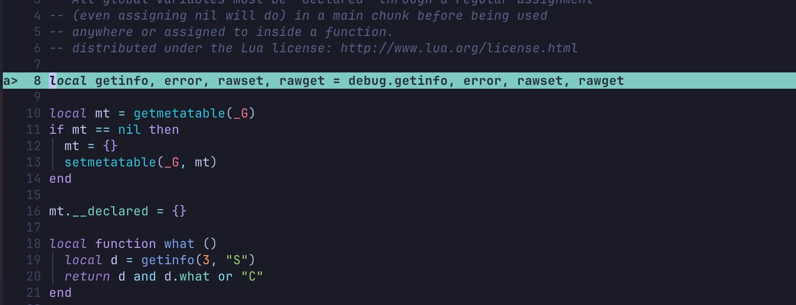

# Hlmarks.nvim

Add functions for mark operations, and highlight using a sign. That's all.



## Features

- Display the names of buffer-marks and file-marks, and highlight the marked lines.
- Remove a mark by executing the corresponding mark command (`m[a-zA-Z]`) on a line where that mark is already present.
- Automatically select an unused mark name and set a mark using that name to the current line.
- Remove all marks present on the same line at once.
- Remove all marks in the current buffer at once.
- Synchronize the state of marks and signs by a specified user event.

## Requirements

- Neovim >= 0.12.4
  - Because it is developed with this version. Since it is simple, I think it will work even in lower versions.
  - Please note that version 0.10 or higher is required to run the tests.

## Installation

Install the plugin with your preferred package manager. Here is an example in [lazy.nvim](https://github.com/folke/lazy.nvim).  
```lua
{
  'AT-AT/hlmarks.nvim',
  lazy = false, -- Avoid lazy loading, as it overrides mark commands.
  opts = {
    -- options...
  },
}
```

## Configuration

Below are the configurable options and their default values.
```lua
{
  -- Buffer-mark specific.
  buffer_mark = {
    -- Highlight color specs for the sign column, line number column, and the line itself.
    ---@see https://neovim.io/doc/user/api.html#nvim_set_hl()
    ---@type { sign_hl|number_hl|line_hl: { [string]: any } }
    highlight = {
      sign_hl = {
        ctermfg = 255,
        ctermbg = 39,
        fg = '#eeeeee',
        bg = '#00afff',
        bold = true,
      },
      number_hl = {
        -- Same as above.
      },
      line_hl = {
        -- Same as above.
      },
    },

    -- Format for the sign column.
    -- "%m" is replaced by the mark name.
    -- The width is a maximum of 2 bytes, including the replaced mark name.
    -- If the width is 1 character, it's left-aligned and the remainder is padded with spaces.
    ---@type string
    sign_format = '%m>',
  },

  -- File-mark specific.
  file_mark = {
    -- Same as buffer-mark.
  },

  -- Priority when overlapping with other signs.
  -- This priority setting applies to both buffer-mark and file-mark signs.
  -- When they overlap, the order is as follows: "(Highest) Z-Az-a (Lowest)".
  ---@type integer
  priority = 100,

  -- Execution interval for synchronization processes.
  ---@type integer (ms)
  sync_interval = 500,

  -- Names of the user event that triggers the execution of the synchronization process.
  ---@type string[]
  event_names = {},

  -- A string that is prepended to the value of the "desc" key when mark commands are overwritten.
  ---@type string
  desc_header = '[[Hlmarks]]: ',
}
```

## Key Mappings

> [!NOTE]
> This plugin overrides the default commands for buffer-marks and file-marks.

This plugin does not provide a default keymap. Below is an example.
```lua
-- Set an unused buffer mark.
vim.keymap.set('n', '<leader>mm', function() require('hlmarks').set_next_buffer_mark() end)

-- Set an unused global mark.
vim.keymap.set('n', '<leader>mM', function() require('hlmarks').set_next_file_mark() end)

-- Remove marks at the current line.
vim.keymap.set('n', '<leader>ml', function() require('hlmarks').remove_on_line() end)

-- Remove all marks in the current buffer.
vim.keymap.set('n', '<leader>mb', function() require('hlmarks').remove_all() end)
```

If you are using Lazy.nvim, you can perform lazy loading at the same time by registering with the `keys` option.
```lua
{
  keys = {
    {
      '<leader>mm',
      function()
        require('hlmarks').set_next_buffer_mark()
      end,
    },
    {
      '<leader>mM',
      function()
        require('hlmarks').set_next_file_mark()
      end,
    },
    {
      '<leader>ml',
      function()
        require('hlmarks').remove_on_line()
      end,
    },
    {
      '<leader>mb',
      function()
        require('hlmarks').remove_all()
      end,
    },
  },
}
```

## License

[MIT](LICENSE)
